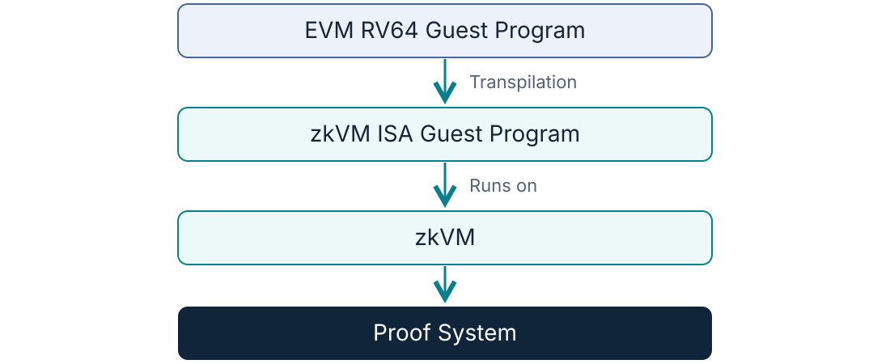
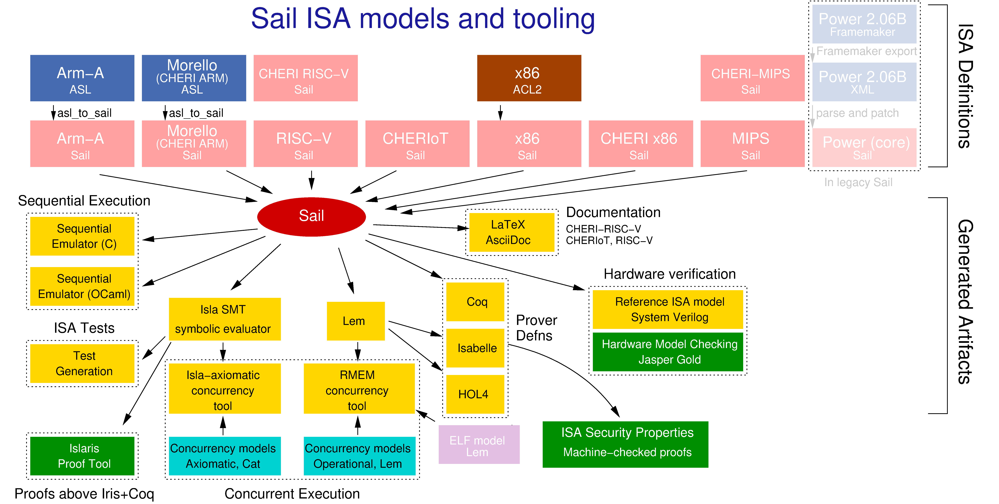
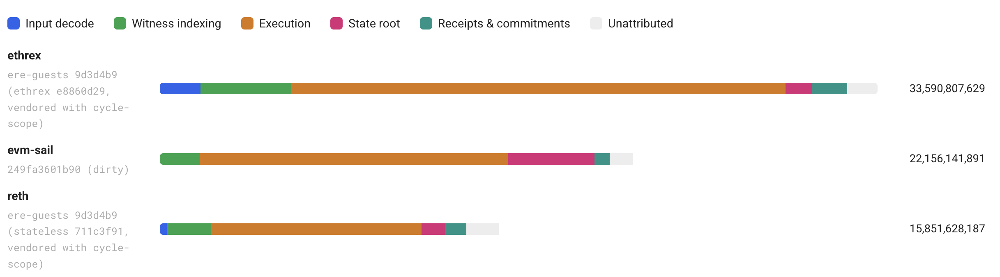

<!-- _class: lead -->
<!-- _paginate: false -->

# A Formal Specification of the EVM in Sail

**Tau Lepton**

zkEVM research engineer · Ethereum Foundation

<!--
Section 1 — introduction. Provisional 30-minute technical talk, excluding Q&A.
I'm a zkEVM research engineer at the Ethereum Foundation, and I'm interested
in formally verifying the EVM. This talk is about building a formal specification
in Sail: what worked, what proved difficult, and how that experience is shaping
the next version.
Draft based on evm-sail adc44afd21ef6d5a45c96046f0d23f527acbf54e, inspected 2026-10-15.
-->

---

01 · Motivation

## zkEVM Verification Problem

<!--
Follow the execution pipeline: the EVM RV64 guest program is transpiled to the
zkVM ISA guest program, which runs on the zkVM. The zkVM feeds the proof system.
This is the architecture motivating verification, not a claim of completed proofs.
-->

---

04 · Verification scope

## What exactly are we verifying?

<strong>Block kernel</strong> 
Does the block apply the right transactions and system operations?

<strong>Transaction kernel</strong> 
Is the transaction valid, executed, and settled correctly?

<strong>EVM machine</strong> 
Does the program execute according to the EVM rules?

Each scope needs its own correctness claim—and a connection to the others.

Conceptual verification boundaries, not existing package names. Sources: <a href="https://github.com/frisitano/evm-sail/blob/adc44afd21ef6d5a45c96046f0d23f527acbf54e/book/docs/introduction.md">Model structure</a>.

<!--
Nesting illustrates ordinary transaction execution. Block system operations can
also invoke the machine. The key point is scope, not the detailed call graph.
-->

---

<!-- _class: overview -->

02 · Sail and the model

Image: <a href="https://raw.githubusercontent.com/rems-project/sail/refs/heads/sail2/etc/overview/overview-sail.png">REMS Project · Sail ISA models and tooling</a>. Wider Sail ecosystem; not an EVM Sail integration list.

<!--
Sail is a language for describing instruction-set semantics, with executable
and proof-assistant outputs. Walk the diagram from ISA models to Sail, then
follow only the executable-emulator and theorem-prover paths.
The figure includes Coq, Isabelle and HOL4; EVM Sail's inspected proof targets
are Lean and Rocq. Do not imply every pictured integration is implemented here.
-->

---

03 · Results

## What have we achieved?

- **Executable specification:** run the model and compare its behaviour with execution-specs.
- **Multiple execution targets:** reference and optimized execution from a shared Sail model.
- **Proof-assistant outputs:** Lean and Rocq definitions provide a starting point for proofs.

Implemented capabilities, not end-to-end verification. Sources: <a href="https://github.com/frisitano/evm-sail/blob/adc44afd21ef6d5a45c96046f0d23f527acbf54e/book/docs/extractions.md">Targets</a> · <a href="https://github.com/frisitano/evm-sail/actions/runs/32505286476">Reviewed CI run</a>.

<!--
Distinguish execution, differential testing, and proof. These are different kinds
of evidence. Do not claim full test-suite conformance or complete EVM correctness.
-->

---

03 · Challenges

## What has been difficult?

**Semantic coverage**  
Correct instructions are only part of correct transaction and block execution.

**Proof usability**  
Generating definitions is easier than making them convenient to reason about.

**Execution performance**  
A clear specification still needs to run efficiently enough to test and use.

Sources: <a href="https://github.com/frisitano/evm-sail/blob/adc44afd21ef6d5a45c96046f0d23f527acbf54e/book/docs/introduction.md">Model scope</a> · <a href="https://github.com/frisitano/evm-sail/blob/adc44afd21ef6d5a45c96046f0d23f527acbf54e/book/docs/engineering.md">Engineering experience</a>.

<!--
Frame these as lessons from building the workflow. The next slides explain
their consequences, without descending into instruction implementations.
-->

---

05 · Proof-assistant extraction

## One model, multiple proof environments

### The benefit

Reuse the Sail specification in **Lean and Rocq**.

Spend proof effort on properties rather than rewriting the entire model.

### The cost

Generated definitions are not always proof-friendly.

External assumptions and changes to generated output still need careful management.

**Result:** proof work can start from the model; extraction alone does not prove correctness.

Source: <a href="https://github.com/frisitano/evm-sail/blob/adc44afd21ef6d5a45c96046f0d23f527acbf54e/book/docs/extractions.md">Extraction targets and external boundaries</a>.

<!--
There are narrow existing proof examples, but no complete EVM correctness result.
Do not present extraction as a verified source-to-binary compilation pipeline.
-->

---

06 · Modified compiler and performance

## Making the model practical to run

- **Type-driven lowering: semantic types become machine types.** The compiler uses the model’s types to choose efficient execution representations.

<!--
Semantic types express what values mean in the model; machine types determine
how execution stores and manipulates them. Type-driven lowering connects the two.
The optimized EVM-word representation uses four 64-bit limbs. This is a compiler
design choice, not an end-to-end correctness proof or a measured speedup claim.
-->

---

07 · Future refactor · proposed direction

## What we would change next

**Clearer execution boundaries**  
Make the machine, transaction, and block responsibilities easier to isolate.

**Proof-friendly interfaces**  
Expose smaller correctness claims that can be connected.

**Performance-aware structure**  
Keep efficient execution and a readable specification viable together.

Intended payoffs: clearer scope, easier proofs, faster iteration.

<!--
These are proposed priorities for discussion, not a committed implementation plan.
The actual refactor and its proof milestones still need presenter confirmation.
-->

