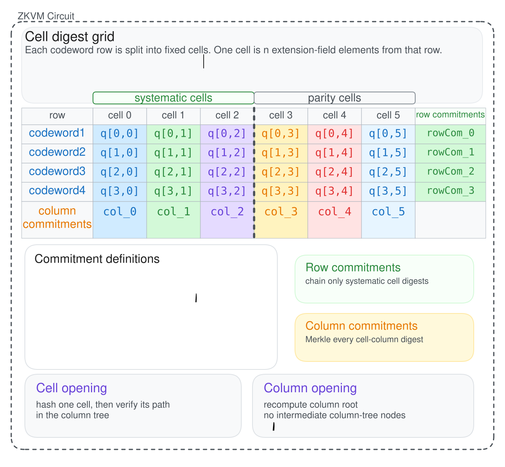
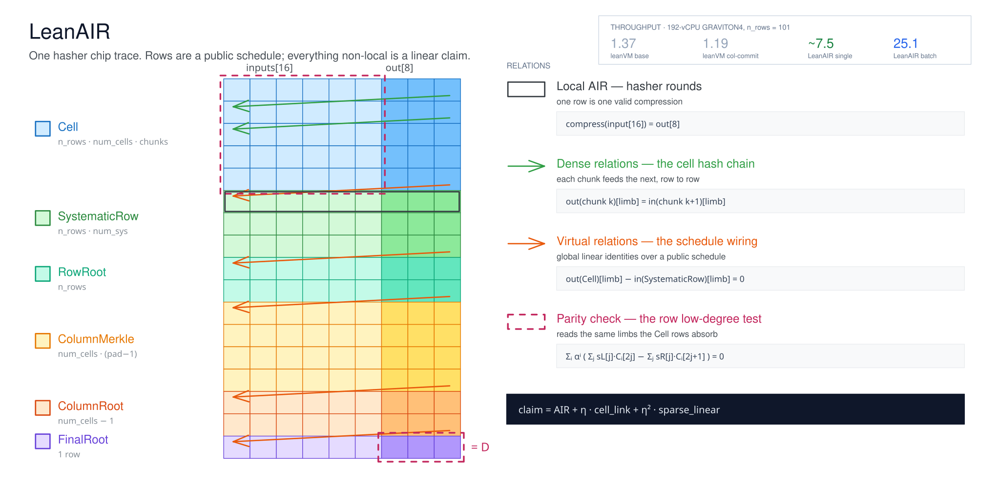

<!-- _class: lead -->

# leanDA & DA.fast

## Post-quantum data availability — the construction, the prover, and the open search

**Tau Lepton** · 12 October 2026

---

## What this covers

**The construction.** Where the leanDA commitment stands, and precisely what binds what.

**The prover.** LeanAIR — proving that commitment directly, with the VM layer removed.

**The search.** DA.fast — four constructions in six months, all hand-designed. Automating the space.

Then four protocol questions that fall out of having cheap post-quantum DA:

- **BiB** — the execution payload leaves the consensus layer
- **To blob or not to blob** — and whether packing is the right primitive
- **Blobpool proving** — recursive aggregation via EIP-8288
- **Decentralised state and history** — custody groups, enhanced BALs

---

<!-- _class: dense -->

## Three constructions, and why we moved

### 1 — RLC + FRI fold in circuit
Combine every row into one extension-field aggregate codeword, fold it inside the leanVM trace, assert the final vector is constant.
**364 KB/s** at $m=240$, $n=4096$.

### 2 — Barycentric check per row
Drop folding entirely. One algebraic identity per row, same challenge for all rows.
**931 KB/s** at 16 blobs.

### 3 — Systematic row digests + column Merkle
Give the *commitment* structure instead of giving the *proof* more work. Cell-level sampling becomes possible.
**1,150 KiB/s** at 46 blobs.

Each step removed proof work that was not buying soundness.

Construction 1 proves a fold. Construction 2 proves an identity. Construction 3 proves an identity over a commitment shaped so that sampling is cheap.

The through-line: move structure out of the relation and into the commitment, then prove only what the commitment cannot enforce by construction.

That same instinct, pushed one step further, is the hashless direction later in this talk.

---

<!-- _class: tight -->

## The commitment scheme

**1. Hash each cell.** Split every row into aligned cells of $L$ extension-field elements; chain-hash its base-field limbs into one 8-FE digest.

$$
q_{i,j}=H_{\mathrm{chain}}(\operatorname{chunks}(\operatorname{limbs}_{\mathbb{F}}(\mathrm{cell}_{i,j})))
$$

**2. Chain only *systematic* cell digests per row.** The row digest ignores parity cells.

$$
\mathrm{row}_i=H_{\mathrm{chain}}(q_{i,0},\ldots,q_{i,N_{\mathrm{sys}}-1})
$$

$$
R_{\mathrm{rows}}=H_{\mathrm{chain}}(\mathrm{row}_0,\ldots,\mathrm{row}_{B-1})
$$

**3. Merkle-commit every cell column.**

$$
\mathrm{col}_j=\operatorname{Merkle}(q_{0,j},\ldots,q_{B-1,j},0,\ldots)
$$

$$
R_{\mathrm{col}}=\operatorname{Merkle}(\mathrm{col}_0,\ldots,\mathrm{col}_{N-1})
$$

**4. Bind the two.**  $D=H(R_{\mathrm{rows}},R_{\mathrm{col}})$

**The asymmetry is deliberate.** Row digests cover systematic cells only — they name the *data*. Columns cover every cell including parity — they support *sampling*.

---

## What binds what

**A cell opening** verifies one cell through its column tree path.

**A column opening** recomputes the column root from the full opened digest column.

**A row digest** gives per-blob identity without a per-blob Merkle tree.

**The parity check** does not read a separate codeword witness. Every limb

$$C_i[t].\mathrm{limb}_k$$

maps to the exact $(\textit{trace row}, \textit{input column})$ where the `Cell` hash row absorbs it.

**So the values tested for Reed–Solomon membership are, by construction, the values committed.**

Not two hash-based binding structures glued together and argued to agree — one object, opened two ways.

This is what makes the later hashless step conceivable. If the low-degree test already reads committed trace values, the Poseidon/Merkle computation inside the relation is doing bookkeeping, not binding.

---

<!-- _class: dense -->

## The row low-degree test

For row codeword $C_i$ of length $2M$, with $w$ a primitive $2M$-th root of unity and $u=w^2$, the even and odd halves define interpolants $L_i$ and $R_i$. A valid row satisfies $L_i \equiv R_i$. At challenge $r$:

$$
\sum_{j=0}^{M-1}s_L[j]\,C_i[2j]\;=\;\sum_{j=0}^{M-1}s_R[j]\,C_i[2j+1]
\qquad
s_L[j]=\frac{r^M-1}{ru^{-j}-1},\quad
s_R[j]=-\frac{r^M+1}{rw^{-1}u^{-j}-1}
$$

All rows are batched under a challenge derived from the public commitment, so one claim covers the batch:

$$
\sum_i \alpha^i\left(\sum_j s_L[j]\,C_i[2j]-\sum_j s_R[j]\,C_i[2j+1]\right)=0,
\qquad \alpha = H(\ldots \| D)
$$

| blobs | cycles | Poseidon16 | proof | throughput |
|---:|---:|---:|---:|---:|
| 12 | 261,655 | 133,135 | 319.83 KiB | 770.04 KiB/s |
| 24 | 448,463 | 266,271 | 338.14 KiB | 711.70 KiB/s |
| 46 | 821,011 | 513,087 | 363.20 KiB | **1,150.06 KiB/s** |

---

<!-- _class: tight -->

## LeanAIR — the circuit

---

## DA.fast — the problem

Four constructions in roughly six months. Each one hand-designed, each a single point in a space whose axes we can already name.

**The axes are known:**

- what is arithmetized vs. what is a PCS opening
- materialized roots vs. virtual views
- where the low-degree test lives
- cell geometry — $L$, systematic fraction, chunking
- hash and field choice
- proof backend and recursion shape

We are searching by hand a space we can describe.

The bottleneck is not insight. It is that each point costs weeks of implementation to evaluate, so we evaluate very few of them.

**DA.fast** is an autoresearch harness over that space: generate candidate constructions, implement and benchmark them automatically, and let the search rather than the calendar decide what gets built.

---

<!-- _class: dense -->

## DA.fast — the strongest known direction

**Hashless, PCS-native LeanAIR.** Stop arithmetizing the commitment computation. Commit the cell trace directly, prove *only* the row low-degree condition, and let PCS openings certify sampled cells, rows and columns against the same top-level object $D$.

**Removed from the relation:**

- the dedicated Poseidon trace
- cell hash chain links
- row digest links
- column Merkle links and column-root links
- the final-root hash

**What stays:**

- the row parity check — already the component we want
- WHIR, which still uses Merkle internally as its PCS mechanism

"Hashless" means no Poseidon/Merkle computation is arithmetized *inside* LeanAIR — not that hashing disappears.

First implementation should be a **single global-trace commitment with virtual row and column views**, rather than materialized row and column roots.

---

## BiB — Block-in-Blobs

The execution payload leaves the consensus layer. It becomes a non-first-class citizen with a **1-of-N** availability assumption, and block data is reconstructed by streaming chunks from blobs rather than carried as a monolithic payload.

**What this reopens:**

- how RPCs and indexers access block data
- how archival nodes store and serve historical execution data
- transaction inclusion proof mechanisms
- light-client proof generation
- the boundary between consensus-persisted and blob-reconstructed data

**Position:** blocks-from-blobs should not be the primary source of truth for execution data.

There has to be a clear boundary for data alignment between the consensus and execution layers, and "reconstruct it from blobs" does not draw one.

---

## To blob or not to blob

**The proposal.** Under BiB we gossip payload blobs anyway. So blob transactions look redundant — drop them, and put the data in calldata instead.

**Two objections.**

**It bloats the payload.** Calldata is payload; blobs are not.

**It changes the retention class.** Payload must be retained to the **history requirement**. Blobs have a **fixed, bounded lifespan**.

Unifying the two silently converts bounded-lifetime data into history-lifetime data.

That is the cost the proposal does not price. The blob/calldata split is not only an availability mechanism — it is a *retention* mechanism, and collapsing it discards the shorter guarantee.

Any serious unification therefore needs an explicit lifetime dimension in pricing, not just a size dimension.

---

## Packing — or not packing

Today the grid is fixed and data is packed into it during block building.

**Alternative:** treat each blob as an **arbitrary-sized erasure-coded bytestring**, and assign custody groups over **cells of the blob** rather than over a traditional fixed grid.

**What this buys:**

- blob size decouples from a protocol-fixed grid
- no packing step at build time
- custody is expressed over the object that actually exists

**Prior art on the time dimension:** EIP-8256 (Blob Streaming) splits propagation into ahead-of-time and just-in-time lanes, with AOT capacity gated by a ticket contract, so sampling can cover the whole slot.

Different mechanism, same underlying observation — blob delivery has a time shape, and the protocol currently ignores it.

---

<!-- _class: dense -->

## Blobpool proving

Generate recursive proofs of the blob transaction in the pool, and use **EIP-8288** for recursive aggregation.

**EIP-8288** — in-mempool signature and proof aggregation (Buterin, Coratger).

- mempool nodes aggregate every `AGGREGATION_INTERVAL = 1000` ms
- a mode-1 wrapper is one recursive STARK over all still-valid transactions
- nodes recursively combine each other's aggregates
- builder overhead is a fixed **~256 kB per interval**

**Same proof system.** So a DA proof is not a second scheme running alongside — it is another leaf in the same recursive tree.

One prover, one recursion, one verifier in the header. The DA statement is **absorbed into the existing ~256 kB**, not added to it.

`AGGREGATED_VK` and `DEPS_HASH` are still TBD in the spec, and 8288 concedes the header-size cost of carrying a recursive STARK.

---

## Decentralised state & history

**Shard peers into state custody groups.** Each peer is assigned a shard rather than the whole state.

**Enhanced BALs** carry merkle branches for the boundaries of each shard, and the BALs are placed in blobs.

**Each peer maintains a finalized snapshot** of its assigned shard and advances it using those enhanced BALs.

**Availability** of state updates is ensured by erasure coding.

**Durability** is ensured by replicating each shard across peers.

**Mempools** are maintained by requesting state proofs from peers and updating them with BALs.

The BAL stops being an execution optimisation and becomes the state-synchronisation primitive: the thing that lets a peer holding one shard stay correct about its shard without seeing the rest.

---

## What that costs

No peer holds full state. So every operation that used to be local becomes a **network request plus a proof verification**.

Mempool validation is the sharpest case: transaction admission now depends on peers answering state-proof requests inside the admission window.

**The trade to argue:** state size stops being a per-node cost and becomes a network-wide one, paid in latency and in liveness coupling between peers.

Erasure coding covers availability and replication covers durability — but neither covers a peer that is simply slow to answer.

---

<!-- _class: dense -->

## Where this leaves us

**Construction.** The hashless PCS-native design is the next concrete step. DA.fast is how we get past it without another six months of hand-designed points.

**Prover.** LeanAIR already removed the VM layer. The remaining question is which backend, and that is decided by what 8288's aggregation settles on — not chosen independently.

**Retention is the unpriced dimension.** The blob-or-calldata debate is really about lifetime, and neither side currently prices it.

**Custody over cells, not over a grid**, is what makes packing unnecessary rather than merely cheaper.

**Decentralised state** is the furthest out, and the honest open question is admission latency, not correctness.

---

<!-- _class: lead -->

# Questions

**leanDA** · `frisitano/leanDAS`, `leanEthereum/leanMultisig`

**LeanAIR** · `crates/lean-air`

**Aggregation** · EIP-8288
