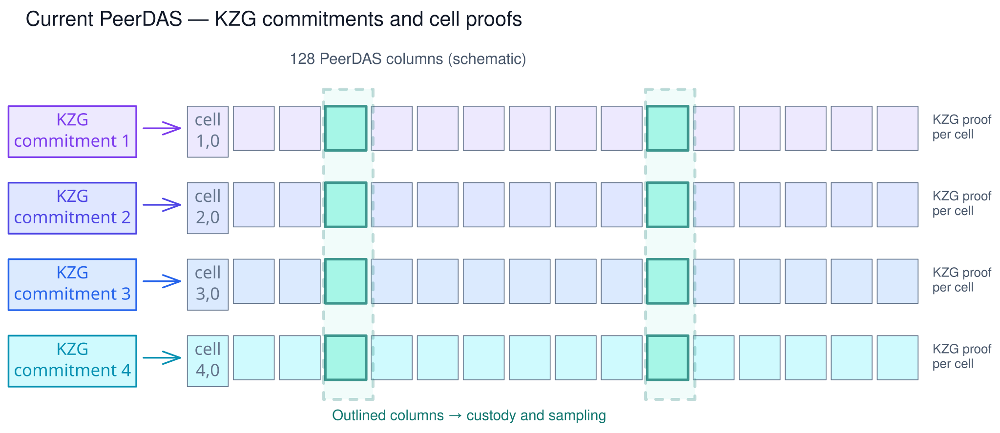
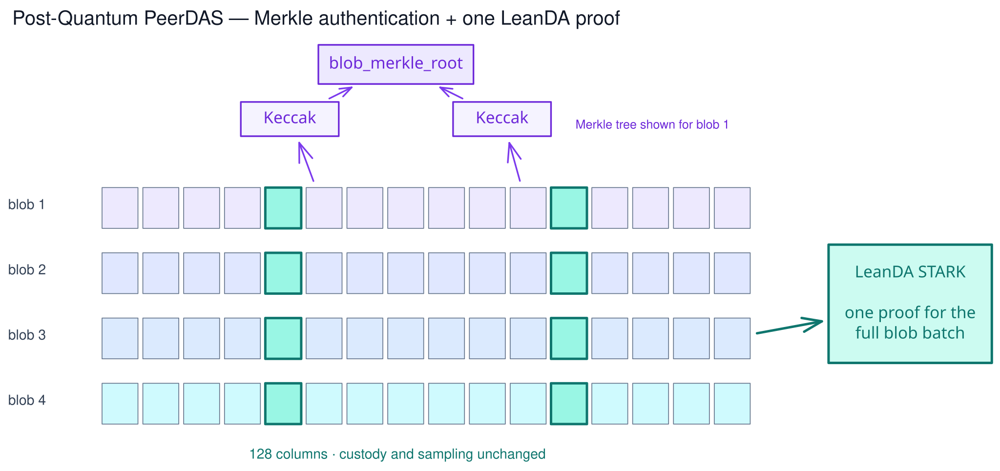
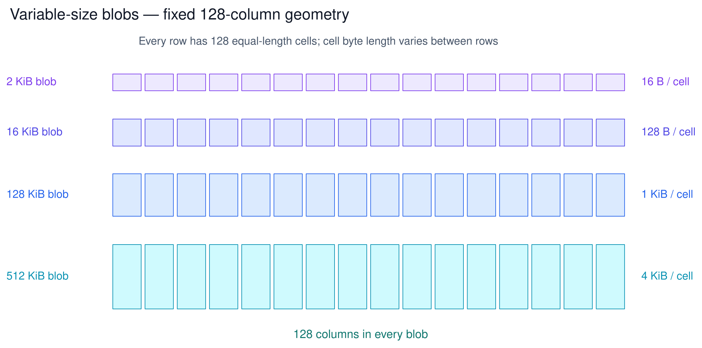
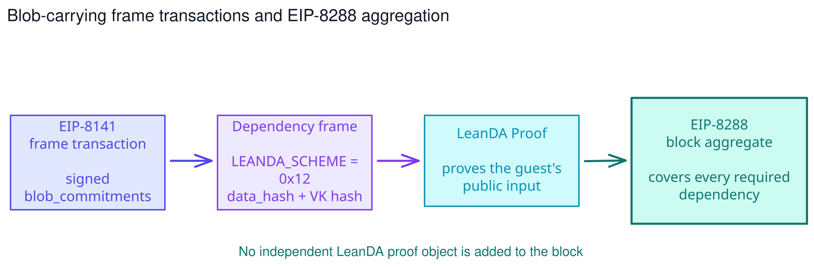
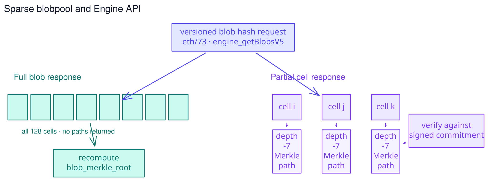
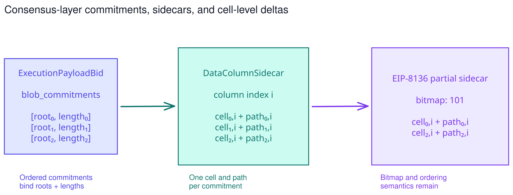

<!-- class: lead -->
<!-- paginate: false -->

EIP-8479 · Draft

# Post-Quantum Data Availability

## Post-Quantum PeerDAS and Variable-Size Blobs

<strong>Francesco Risitano</strong> · EF Research Engineer · 1 November 2026

---

<!-- class: -->
<!-- paginate: true -->

Current state

## KZG PeerDAS

One commitment per blob row · one proof per cell · columns define custody and sampling

---

EIP-8479

## Post-Quantum PeerDAS

The illustrated guest batch has one LeanDA proof; EIP-8288 later folds required proofs into the block aggregate.

---

Variable-size blobs

## Fixed columns, variable cell byte lengths

  
<strong>2–512 KiB</strong> permitted blob lengths

  
<strong>128 cells</strong> in every blob

  
<strong>16 B–4 KiB</strong> per-cell byte length

---

Commitment and proof statement

## Blob commitments and the LeanDA guest

### Guest inputs

~~~python
class BlobCommitment:
    blob_merkle_root: Bytes32
    blob_byte_length: Uint64

class PublicInput:
    blob_commitments: list[BlobCommitment]

class Blob:
    data: bytes

class PrivateInput:
    blobs: list[Blob]
~~~

The root authenticates the 128 cells. The signed byte length fixes how those cells are interpreted.

### Guest validation

~~~python
def verify_blob(blob):
    length = len(blob.data)
    assert is_valid_blob_byte_length(length)

    root = compute_blob_merkle_root(blob.data)
    assert verify_reed_solomon_relation(
        blob.data, root
    )
    return BlobCommitment(root, length)

def run_guest(public_input, private_input):
    assert public_input.blob_commitments == [
        verify_blob(blob)
        for blob in private_input.blobs
    ]
~~~

---

Execution layer

## EIP-8141 frame transactions + EIP-8288

<strong>No new transaction type.</strong> EIP-8141’s signed <code>blob_versioned_hashes</code> list becomes ordered <code>blob_commitments</code>.

Every blob-carrying frame declares its required <code>LEANDA_SCHEME</code> dependency.

---

Execution semantics and fees

## BLOBHASH and byte-based blob gas

### Versioned hash

0x02 || keccak256(   blob_merkle_root || uint64_le(blob_byte_length) )[1:]

<code>BLOBHASH(i)</code> derives this value from signed commitment <em>i</em>, or returns zero when the index is out of range.

Mixing in the length prevents a root from being interpreted under another blob size.

### Accounted bytes

blob_gas = blob_byte_length + 4,064

Internal Merkle nodes<strong>127</strong>

Hash bytes per node<strong>32</strong>

Legacy-sized blob charge<strong>135,136</strong>

The target and maximum become blob-gas budgets derived from the active EIP-7892 schedule. The fixed allowance is a consensus accounting convention, not an estimate of every peer’s wire usage.

---

Execution networking

## Sparse blobpool and Engine API

  
<strong><code>eth/73</code></strong> advertises commitments and exchanges variable-length cells.

  
<strong><code>engine_getBlobsV5</code></strong> remains requested by derived versioned hash.

---

Consensus layer

## Commitments, sidecars, and cell-level deltas

  
The CL derives ordered versioned hashes from <code>ExecutionPayloadBid.blob_commitments</code> for <code>NewPayload</code>.

  
EIP-8136 keeps its bitmap and ordering rules; <code>kzg_proofs</code> becomes <code>authentication_paths</code>.

---

Fork and trust boundary

## Activation and security

### At the fork

- Historical data remains valid under its original rules.
- Type-3 and legacy KZG blob transactions become invalid for new inclusion.
- Transaction pools remove ineligible KZG transactions.
- <code>eth/73</code> and Engine API V5 carry the new formats.

---

<!-- class: lead -->

EIP-8479 · Draft

# Review the proposal

## Post-Quantum PeerDAS and Variable-Size Blobs

**Draft:** [github.com/frisitano/EIPs/eip-8479.md](https://github.com/frisitano/EIPs/blob/eip-post-quantum-peerdas/EIPS/eip-8479.md)  
**Discussion:** [ethereum-magicians.org/t/30167](https://ethereum-magicians.org/t/eip-8479-post-quantum-peerdas-and-variable-size-blobs/30167)

Rollups and blob users: are variable-size blobs valuable to you—and why?

